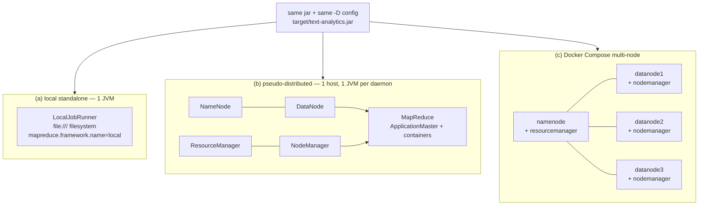
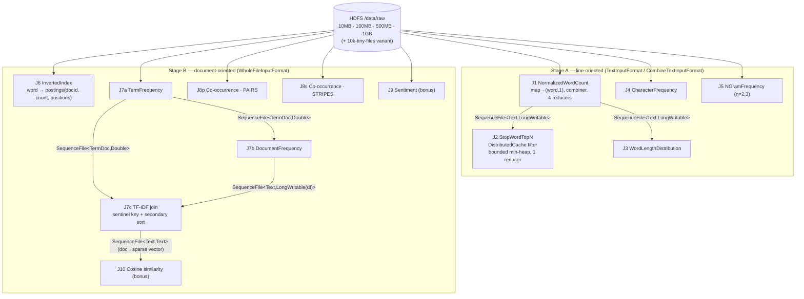
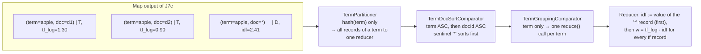

# 01 — Architecture Overview

**Project:** Scalable Text Analytics Platform on Hadoop MapReduce
**Deliverable:** Part 1 (architecture, data flow, key/value contracts, repository structure, build file)

---

## 1. Scope

A multi-job text-analytics pipeline over large plain-text corpora implemented strictly against the
`org.apache.hadoop.mapreduce` API (not the deprecated `mapred` API), plus:

* three execution modes: local standalone, pseudo-distributed, Docker multi-node;
* four dataset sizes: ~10 MB, 100 MB, 500 MB, 1 GB;
* a Python reference implementation used as a correctness oracle;
* a measurement harness whose *numbers* come from real runs (never invented).

---

## 2. Stated assumptions (verify before submission)

| # | Assumption | Status on the authoring machine | Action |
|---|-----------|--------------------------------|--------|
| A1 | Hadoop **3.3.6** (a 3.3.x release) | not installed on the host | provided by the Docker image; the build and all tests run against it |
| A2 | Java **11** (`maven.compiler.release=11`) | **Java 25** on PATH | Hadoop 3.3.x is not certified on 25 (SecurityManager removal, reflective-access changes); the build must run inside the JDK-11 image. `pom.xml` still compiles to 11 bytecode. |
| A3 | Maven 3.8+ | **not on PATH** | available inside the Docker image; `scripts/01_build.sh` refuses to run without it and prints the exact fix (verified: 3.9.x) |
| A4 | Docker Engine + Compose v2 | Docker 29.9.2 present | OK |
| A5 | GNU Make | Make 4.4.1 | OK |
| A6 | Python 3.9+ for the reference implementation (stdlib only) | Python 3.14.0 | OK |
| A7 | matplotlib for plots only | may be missing | `pip install matplotlib`; the plotting script fails with a clear message if absent |
| A8 | Corpus is **UTF-8 with replacement on malformed bytes** | — | normalisation contract in §5 makes this identical in Java and Python |
| A9 | Windows hosts need `winutils.exe`/`HADOOP_HOME` for local mode | — | avoid local mode on native Windows; use WSL2 or Docker (documented in README troubleshooting) |

> About A1–A3: the host has Java 25 and no Maven, so nothing is built on the host. The build
> and every test run happen inside `maven:3.9-eclipse-temurin-11` (Java 11 + Hadoop 3.3.6),
> which is what `make build` does. That check was run: `mvn -B -Pcoverage-gate verify` ends in
> BUILD SUCCESS with 89 unit tests, 8 integration tests and 85.2 % line coverage (§13.1).

---

## 3. Deployment topologies



Mode selection is **configuration only** — no code branch:

| Mode | Filesystem | Framework | Reducers | Notes |
|------|-----------|-----------|----------|-------|
| local | `file:///` | `local` | forced to 1 by LocalJobRunner | fastest feedback, no HDFS security |
| pseudo | `hdfs://localhost:9000` | `yarn` | 1..8 | exercises real shuffle + HDFS replication |
| multi-node | `hdfs://namenode:9000` | `yarn` | 1..8 | optional; 3 workers. Brought up and validated with real YARN jobs, but the full pipeline was not completed there — §13.6 |

Justification: the job code only ever sees `Configuration`, `FileSystem` and `Path`, so
"runs in 3 modes" is an operational property rather than three code paths — one artifact, one
test suite, one benchmark harness.

---

## 4. Corpus layout, document identity, and small-files handling

```
/data/raw/            one file per "document" (Gutenberg .txt, wiki shard, Kaggle row dump)
/data/stopwords/en-stopwords.txt
/data/lexicon/sentiment-lexicon.tsv
/data/big/10m | 100m | 500m | 1g        synthetic shards for the size study
```

* **Document ID = path relative to the input root**, never an absolute path.
  Justification: absolute paths embed the host and the HDFS URI, which breaks determinism across
  modes and makes the Python reference comparison impossible.
* **Document 1 = 1 file.** `WholeFileInputFormat` therefore defines the document set; jobs that need
  per-document context (inverted index, TF, TF-IDF, sentiment, cosine) use it.
* **Small-files problem is explicit, not accidental.** The generator produces a `10k-tiny-files`
  corpus variant that is *identical in bytes* to the 100 MB corpus but split into 10 000 files.
  Jobs that are line-oriented (word count, lengths, chars, n-grams) switch to
  `CombineTextInputFormat` when `avgFileSize < ta.smallfile.threshold` (default 32 MB), driven by
  one HDFS `listStatus` walk at driver time. This makes the ablation "default vs CombineTextInputFormat"
  a controlled experiment at equal data volume, which is the only way that comparison is meaningful.

---

## 5. Normalisation contract (normative — mirrored 1:1 in Python)

This section exists because "diff = 0 against the Python reference" is a *hard check*. Any
hand-waving here makes that check unachievable. Both implementations must execute these steps in
this order.

Given a raw line `L` (bytes delivered by the record reader):

1. **Decode** as UTF-8 with `CodingErrorAction.REPLACE` (Python: `errors="replace"`) — malformed
   byte sequences become U+FFFD and the line increments `MALFORMED_LINES`.
2. **Unicode NFC** (`java.text.Normalizer.Form.NFC` / `unicodedata.normalize("NFC", s)`).
3. **Lowercase** with `Locale.ROOT` / `str.lower()`.
4. **Strip intra-word apostrophes**: U+0027 `'`, U+2019 `’`, U+02BC `ʼ`, U+FF07 `＇` are deleted,
   so `don't → dont`, `it’s → its`. Justification: keeps contractions as one token, which is what
   TF-IDF and the inverted index want; splitting them corrupts both the term vocabulary and the
   position index.
5. **Tokenise**: split on every code point whose Unicode general category is *not* `L*`, `M*` or
   `N*`. Consequences, all intentional: `state-of-the-art → state, of, the, art` (hyphen is
   punctuation); emoji and currency signs (categories `So`/`Sc`) are separators and are counted in
   `SYMBOL_CHARS_DROPPED`; combining marks stay attached.
6. **Number handling** — `ta.number.mode` ∈ `keep | drop | mask`, default **`mask`**:
   a token consisting only of `Nd` digits becomes the single literal token `<num>`.
   Justification: keeps document-frequency shape for numeric text (years, page ids) while keeping
   random numeric identifiers out of the Top-N; `keep` pollutes the head of a Zipfian distribution,
   `drop` silently deletes signal.
7. **Drop empty tokens** and tokens shorter than `ta.min.token.length` (default 1).
8. **Positions**: code-point/ token ordinal inside the document, 0-based, monotonically increasing;
   line-oriented jobs reset the ordinal at each line break.

Object-reuse note: the tokeniser writes into a caller-supplied `Text` (and `IntWritable`) — no
allocation per token. That is the single largest GC win in the mapper hot loop.

**Ordering/comparison contract.** All sorting uses `org.apache.hadoop.io.Text.compareTo`, which
compares **unsigned UTF-8 bytes**. UTF-8 byte order is identical to Unicode code-point order, which
is exactly Python's `str` ordering. Using `String.compareTo` (UTF-16 code-unit order) instead would
diverge from Python for astral-plane letters such as Deseret/Gothic (both appear in full Wikipedia
dumps). This is a real, testable correctness detail, and `ComparatorsTest` pins it.

**Output formatting contract.** TAB-separated fields, `\n` records, `Locale.ROOT` everywhere,
integers as plain decimal (no grouping separators), doubles as `%.6f` (`f"{x:.6f}"`), line endings
forced to `\n`. Determinism is then a property of (sorted key order) + (fixed formatting) + (fixed
record separator), not of luck.

---

## 6. Pipeline DAG



Edges labelled `SequenceFile` are *intermediate* formats; every terminal result a human or the
verifier reads is **text**, because the Python oracle cannot read a SequenceFile without a JVM.

### 6.1 TF-IDF chain and the join strategy (documented, because it is the usual failure point)



* **Why a reduce-side join with a sentinel key and not a map-side join?** The DF side is the
  term vocabulary — potentially tens of millions of entries on a 1 GB corpus — so broadcasting it
  through `DistributedCache` would blow up every container's heap. Reduce-side join costs one extra
  shuffle but has bounded memory per key. *(A map-side join is implemented as an ablation for the
  10 MB/100 MB case where DF does fit, which is exactly how the crossover is demonstrated.)*
* **Why a sentinel order rather than two passes?** Ordering the DF record first inside the
  secondary sort gives the reducer `idf` in hand before it streams the TF records for that term,
  so the join needs no buffered side list. This is the standard "secondary sort as a join
  enabler" pattern (Lin & Dyer, *Data-Intensive Text Processing with MapReduce*, ch. 3).
* **Why `TermPartitioner` and not `HashPartitioner` on the whole composite key?** Partitioning on
  the full `(term, doc)` key would scatter a term's DF record and TF records across reducers, so no
  reducer would ever see a complete join group.
* **TF-IDF formula (fixed, so Python can reproduce it exactly):**
  `tf_raw = n(t,d)`, `tf = 1 + log10(tf_raw)`, `idf = log10(N / df(t))`, `w = tf · idf`,
  `N = number of documents` (counted once by the driver from `listStatus`, cross-checked against the
  `DOCUMENTS` counter). Variants `raw`, `log`, `augmented` are selectable via `ta.tf.mode` and all
  are pinned by the reference implementation.

---

## 7. Key/value types at every stage (the contract table)

Notation: `K→V` per record; `I` = input, `M` = map output, `C` = combiner, `R` = reduce.

### J1 NormalizedWordCount
| Stage | Key | Value |
|---|---|---|
| I | `LongWritable` (byte offset) | `Text` (raw line) |
| M | `Text` (normalised token) | `IntWritable(1)` |
| C | `Text` | `IntWritable` (partial sum) |
| R | `Text` | `LongWritable` (count) |
| O | SequenceFile `Text,LongWritable` (chained) — text variant `word\tcount` | |

### J2 StopWordTopN (DistributedCache + bounded min-heap)
| Stage | Key | Value |
|---|---|---|
| I | `Text` (word) | `LongWritable` (count from J1) |
| M | `Text` | `LongWritable` (pass-through; stop words diverted to counters) |
| C | — (single reducer, nothing to combine) | |
| R | `Text` (word) | `LongWritable` (count) |
| O | `rank\tword\tcount` in score order | |

### J3 WordLengthDistribution
| Stage | Key | Value |
|---|---|---|
| I | `LongWritable` | `Text` (line) |
| M | `IntWritable` (token length) | `LongWritable(1)` |
| C | `IntWritable` | `LongWritable` |
| R | `IntWritable` | `LongWritable` |
| O | `length\tcount\tpct` (1 reducer → exact percentages) | |

### J4 CharacterFrequency
| Stage | Key | Value |
|---|---|---|
| I | `LongWritable` | `Text` (line) |
| M | `Text` (single code point) | `IntWritable(1)` |
| C | `Text` | `IntWritable` |
| R | `Text` | `LongWritable` |
| O | `char\tcount\tpct` (1 reducer, cardinality ≤ few thousand) | |

### J5 NGramFrequency
| Stage | Key | Value |
|---|---|---|
| I | `LongWritable` | `Text` (line) |
| M | `Text` (n-gram, components joined by `\u0001`) | `IntWritable(1)` |
| C | `Text` | `IntWritable` |
| R | `Text` | `LongWritable` (pruned below `ta.ngram.minfreq`) |
| O | `ngram\tcount` | |

### J6 InvertedIndex (WholeFileInputFormat)
| Stage | Key | Value |
|---|---|---|
| I | `Text` (docId = relative path) | `Text` (whole document) |
| M | `Text` (word) | `PostingWritable` (`docId`, `count`, `IntArrayWritable` positions) |
| C | `Text` | `PostingWritable` (merge counts/positions of the same word in one document — in-mapper + combiner) |
| R | `Text` (word) | `Text` (postings list) |
| O | `word\tdoc1:3:12,45,90\tdoc2:1:7` | |

### J7a TermFrequency → J7b DocumentFrequency → J7c TF-IDF join
| Job | I | M | R | O |
|---|---|---|---|---|
| J7a | `Text`(docId) → `Text`(doc) | `TermDocWritable` → `IntWritable(1)` | Σ tf | `TermDocWritable` → `DoubleWritable(tf_log)` (seq) |
| J7b | `TermDocWritable` → `DoubleWritable` | `Text`(term) → `IntWritable(1)` | Σ df (+`DOCUMENTS` counter check) | `Text` → `LongWritable(df)` (seq) |
| J7c | `MultipleInputs`: TF tagged `T`, DF tagged `D` | `TermDocWritable` (df record carries sentinel doc `*`) → `TaggedCountWritable` | `term` → `Iterable<TaggedCountWritable>` | `term\tdoc\tw` (text) |

### J8p Co-occurrence · pairs
| Stage | Key | Value |
|---|---|---|
| I | `Text`(docId) → `Text`(doc) | |
| M | `TextPair(word, neighbour)` | `IntWritable(1)` |
| C | `TextPair` | `IntWritable` |
| R | `TextPair` | `LongWritable` |
| O | `w1\tw2\tcount` | |

### J8s Co-occurrence · stripes
| Stage | Key | Value |
|---|---|---|
| I | `Text`(docId) → `Text`(doc) | |
| M | `Text`(word) | `StripeWritable` (map neighbour → count) |
| C | `Text` | `StripeWritable` (associative merge) |
| R | `Text` | `StripeWritable` (merged) |
| O | `w\tneighbour:count,neighbour:count` | |

### J9 Sentiment (bonus)
| Stage | Key | Value |
|---|---|---|
| I | `Text`(docId) → `Text`(doc) | |
| M | `Text`(docId) | `DocumentScoreWritable(pos, neg, tokens)` |
| C | — (one record per document from the mapper, so combining changes nothing) | |
| R | `Text`(docId) | `DocumentScoreWritable` |
| O | `docId\tpolarity\ttokens\tpos\tneg` | |

### J10 Cosine similarity (bonus)
| Stage | Key | Value |
|---|---|---|
| I | J7c output (seq: `doc → term:w`) | |
| M | `TextPair(docA, docB)` for candidate pairs sharing ≥ `ta.sim.min.shared` rare terms | `DoubleWritable(partial dot)` |
| C | `TextPair` | `DoubleWritable` |
| R | `TextPair` | `DoubleWritable(cosine)` |
| O | `docA\tdocB\tcosine` | |

---

## 8. Advanced-engineering decisions and one-line defences

| Requirement | Decision | Viva-ready justification |
|---|---|---|
| Combiner safety | J1/J3/J4/J5/J7a/J7b/J8p/J8s use a combiner | Integer addition and stripe merge are associative **and** commutative, so partial aggregation cannot change the result; J6 is safe too (merge of postings *for the same word and doc*), but J2 cannot use one because a bounded top-N heap is **not** associative. |
| Top-N pattern | Single reducer + bounded min-heap of size N | Exact global top-N in one pass with O(N) memory and O(distinct·log N) time; a total-order secondary sort would shuffle *all* counts through a sampling partitioner to gain nothing, since the head of a Zipf distribution is a handful of terms. Multi-reducer variant (per-reducer top-N + merge job) is implemented as `ta.topn.strategy=secondary` for the ablation. |
| Partitioner | `TermPartitioner` (term-only hash) for J7c, `TextPair`-first-key variants for J8 | Partitioning must agree with the grouping comparator, otherwise a join/group is never complete in one reducer. |
| Skew | `SaltedTermPartitioner` in the ablation | Salting the hot terms spreads a single reducers's load, at the price of a second aggregation pass — reported as measured cost, not magic. |
| In-mapper combining | `ta.combine.mode=none|combiner|inmapper|both` in J1 | In-mapper combining removes most map-output records before the shuffle but requires per-task state and breaks down when the vocabulary exceeds the container heap; measured against the classic combiner. |
| Object reuse | Mapper fields `Text`/`IntWritable`, `set()`/`setValue()` per record | Zero per-record allocation in the hot loop; visible as reduced GC time in the counters table. |
| Compression | Snappy, LZ4, bzip2 and gzip are wired; `-Dta.codec=none|snappy|lz4|gzip|bzip2` selects a map-output codec and, for SequenceFile-writing jobs, the same codec (via the resolver). The resolver probes the codec the way a job actually would (create a compressor **and** decompressor, return them to the pool) before enabling compression, so an unusable codec (missing native library) is reported and skipped instead of lying that it is on and failing later inside IFile. On this JVM-native-libraries-absent build image the verdict is: **bzip2** works (pure Java), gzip fails the probe (no native zlib), lz4 fails (no native lz4), snappy works (native snappy is present in the built image). Measured, not asserted: the benchmark now runs all five and reports the actual shuffle-bytes each produced. |
| Intermediate format | SequenceFile (uncompressed keys, compressed values optional) | Type-safe, splittable, schema-free and dependency-free — Avro/Parquet would add a codec dependency for no benefit at this record shape. |
| Small files | `CombineTextInputFormat` above threshold + `WholeFileInputFormat` where document semantics need whole files | One mapper per 128 MB split, not per 4 KB file; the 10k-files ablation quantifies the difference. |
| Chaining | `JobControl` for independent branches, explicit sequential driver for dependent stages | `JobControl` propagates failures through `getFailedJobs()`; dependent stages must not start until their input exists, which is a control-flow requirement, not a scheduling one. |
| Idempotency | Driver refuses an existing output dir unless `--overwrite` | Prevents the classic `FileAlreadyExistsException` mid-pipeline and makes reruns explicit. |
| Determinism | Sorted keys + `Locale.ROOT` formatting + single-reducer percentage jobs + `Text` byte ordering | Two runs of the same input produce byte-identical files, which the verifier checks with `sha256sum`. |

---

## 9. Counters (all jobs)

`RECORDS_IN`, `TOKENS_EMITTED`, `STOPWORDS_DROPPED`, `STOPWORD_OCCURRENCES_DROPPED`, `EMPTY_LINES`,
`MALFORMED_LINES`, `SYMBOL_CHARS_DROPPED`, `NUMBERS_MASKED`, `NUMBERS_DROPPED`, `TOKENS_TOO_SHORT`,
`LONGEST_TOKEN_LEN`, `DOCUMENTS`, `NGGRAMS_EMITTED`, `NGGRAMS_PRUNED`, `PAIRS_EMITTED`,
`STRIPES_EMITTED`, `NEIGHBOURS_PER_WORD`, `POSTINGS_EMITTED`, `UNKNOWN_LEXICON_WORDS`,
`DOCS_DROPPED_BY_FILTER`.

Counters are used both as instrumentation and as a *self-check* (e.g. `TOKENS_EMITTED` must equal
the sum of J1 counts; the verifier asserts that invariant).

---

## 10. Repository structure

```
BDAV MINI PROJECT/
├── pom.xml                          # §11
├── Makefile                         # build → test → run → verify → bench → clean
├── README.md                        # deliverable 9
├── .gitignore
├── docs/
│   ├── 01-architecture.md           # this file
│   ├── 02-report-outline-ieee.md    # deliverable 10
│   ├── 03-viva-pack.md              # deliverable 11 (slides + 15 Q&A)
│   ├── 04-benchmark-report.md       # deliverable 8 (tables, placeholders until measured)
│   └── img/                         # generated plots
├── conf/
│   ├── core-site.xml  hdfs-site.xml  mapred-site.xml  yarn-site.xml
│   ├── hadoop-env.sh
│   └── log4j.properties
├── docker/
│   ├── docker-compose.yml           # 1 NN/RM + 3 DN/NM
│   ├── Dockerfile                   # ubuntu + JDK 11 + Hadoop 3.3.6 + maven
│   ├── entrypoint-namenode.sh  entrypoint-datanode.sh  healthcheck.sh
├── data/
│   ├── stopwords/en-stopwords.txt   # DistributedCache payload (~120 curated words)
│   ├── lexicon/sentiment-lexicon.tsv
│   ├── raw/                         # downloaded/generated (git-ignored)
│   └── generated/                   # 10m | 100m | 500m | 1g | tiny10k
├── scripts/
│   ├── lib/common.sh                # logging, arg parsing, HDFS helpers, no hardcoded paths
│   ├── 01_build.sh                  # mvn -B clean verify (+ coverage gate)
│   ├── 02_fetch_data.sh             # download Gutenberg/wiki subset OR generate 4 sizes
│   ├── 03_check_stopwords.sh
│   ├── 04_upload_to_hdfs.sh
│   ├── 05_run_all.sh                # every job, one output root per dataset
│   ├── 06_verify_reference.sh       # diff against Python (diff must be 0)
│   ├── 07_benchmark.sh              # all experiments → results/csv/*.csv
│   ├── 08_fault_tolerance.sh        # kill -9 a container mid-job, compare hashes
│   └── 99_clean.sh
├── python/
│   ├── reference/{tokenizer,wordcount,topn,length_char,ngram,inverted_index,tfidf,cooccurrence,sentiment}.py
│   ├── verify_outputs.py
│   ├── bench_aggregate.py
│   ├── bench_plot.py
│   └── baselines/bench_python_baseline.py
├── results/{csv,plots,logs}/
└── src/
    ├── main/java/edu/bdav/ta/
    │   ├── Main.java                        # argv dispatcher
    │   ├── cli/{JobBootstrap,ExitCodes,UsageException}.java
    │   ├── config/{ConfKeys,ConfigSupport}.java
    │   ├── counters/AnalysisCounters.java
    │   ├── text/{TextNormalizer,NGramBuilder,StopWordDictionary,SentimentLexicon}.java
    │   ├── types/{TextPair,TermDocWritable,StripeWritable,PostingWritable,
    │   │          IntArrayWritable,TaggedCountWritable,DocumentScoreWritable}.java
    │   ├── io/{WholeFileInputFormat,WholeFileRecordReader,OutputFormats}.java
    │   ├── partition/{TermPartitioner,SaltedTermPartitioner}.java
    │   ├── sort/{TermDocSortComparator,TermGroupingComparator,CountDescTermAscComparator}.java
    │   ├── reduce/TopNHeapReducer.java
    │   ├── driver/{Pipeline,PipelineDriver}.java
    │   └── job/
    │       ├── wordcount/{NormalizedWordCountJob,NormalizingWordCountMapper,
    │       │              IntSumCombiner,LongSumReducer}.java
    │       ├── topn/{StopWordTopNJob,StopWordFilterMapper,SecondarySortTopNJob}.java
    │       ├── length/{WordLengthJob,WordLengthMapper,WordLengthReducer}.java
    │       ├── charfreq/{CharacterFrequencyJob,CharacterFrequencyMapper,CharacterFrequencyReducer}.java
    │       ├── ngram/{NGramJob,NGramMapper,NGramReducer}.java
    │       ├── inverted/{InvertedIndexJob,InvertedIndexMapper,
    │       │             InvertedIndexCombiner,InvertedIndexReducer}.java
    │       ├── tfidf/{TfJob,TfMapper,TfCombiner,TfReducer,
    │       │          DfJob,DfMapper,DfCombiner,DfReducer,
    │       │          TfIdfJoinJob,TfIdfJoinMapper,TfIdfJoinReducer}.java
    │       ├── cooccur/{PairsCooccurrenceJob,PairsMapper,PairsCombiner,PairsReducer,
    │       │            StripesCooccurrenceJob,StripesMapper,StripesCombiner,StripesReducer}.java
    │       ├── sentiment/{SentimentJob,SentimentMapper,SentimentReducer}.java
    │       └── similarity/{CosineSimilarityJob,DocVectorMapper,CosineReducer}.java
    ├── main/resources/defaults.properties
    ├── test/java/edu/bdav/ta/
    │   ├── text/TextNormalizerTest.java
    │   ├── types/{TextPairTest,TermDocWritableTest,StripeWritableTest,
    │   │          PostingWritableTest,IntArrayWritableTest}.java
    │   ├── sort/ComparatorsTest.java
    │   ├── partition/{TermPartitionerTest,SaltedTermPartitionerTest}.java
    │   ├── job/…  (Mapper/Combiner/Reducer tests per job package)
    │   ├── io/WholeFileInputFormatTest.java
    │   ├── integration/{LocalJobRunnerIT,EdgeCaseIT,DeterminismIT}.java
    │   └── it/{FaultToleranceIT,SmallFilesIT}.java        # -Pminicluster
    └── test/resources/{fixtures/,stopwords-test.txt,log4j.properties}
```

---

## 11. Build file

`pom.xml` is on disk (repository root). Dependency rationale:

| Artifact | Version | Scope | Why |
|---|---|---|---|
| `hadoop-common` | 3.3.6 | provided | `Configuration`, `Text`, `FileSystem`, `SequenceFile`, `ToolRunner` |
| `hadoop-mapreduce-client-core` | 3.3.6 | provided | `org.apache.hadoop.mapreduce` API only — never `mapred` |
| `hadoop-mapreduce-client-jobclient` | 3.3.6 | provided | `LocalJobRunner` for local mode and integration tests |
| `hadoop-hdfs-client` | 3.3.6 | provided | driver-side `exists`/`delete`/`listStatus` |
| `slf4j-api` + `slf4j-reload4j` | 1.7.36 | compile / test | logging; reload4j is the binding Hadoop 3.3.x itself ships |
| `junit` | 4.13.2 | test | plain JUnit 4 keeps the Mockito-driven mapper tests free of a runner dependency |
| `mockito-core` | 4.11.0 | test | mocks `Mapper.Context`, `Reducer.Context`, counters |
| `hadoop-minicluster` | 3.3.6 | test (profile) | MiniDFSCluster fault-injection tests, enabled only in `-Pminicluster` |

`maven.compiler.release=11` is the honest way to pin the target (not `source`/`target`, which
allows linking against newer JDK APIs). The shaded jar deliberately excludes Hadoop (≈200 KB vs
≈400 MB) so it can be `docker cp`-ed into any container.

---

## 12. Part-by-part delivery roadmap

| Part | Contents |
|---|---|
| **1 (this)** | §1 architecture, data flow, KV contracts, repo structure, `pom.xml` |
| 2 | §3 full Java sources, part A: common/text/types/io + J1–J5 |
| 3 | §3 full Java sources, part B: J6–J10 (index, TF-IDF chain, pairs/stripes, bonus) + driver + chaining |
| 4 | §4 Docker Compose + Hadoop XML configs, §5 test suite + commands |
| 5 | §6 run scripts, §7 Python reference + verifier, §8 benchmark harness + plots |
| 6 | §9 README, §10 IEEE report outline, §11 viva pack, §12 limitations/future work |

---

## 13. Measured results (what was actually run)

This section records only numbers produced by an executed command in this repository. The
full data lives in `results/csv/` and the raw transcripts in `results/logs/`.

### 13.1 Build, tests, coverage

| Check | Command | Result |
|---|---|---|
| Compile + package | `mvn -B -DskipTests package` | BUILD SUCCESS, `text-analytics.jar` 200 243 bytes |
| Unit + integration tests | `mvn -B verify` | 89 unit + 8 integration tests, 0 failures |
| Coverage gate (80 % lines) | `mvn -B -Pcoverage-gate verify` | **85.2 % (1 835 / 2 153 lines)**, from `target/site/jacoco/jacoco.csv` |

Lowest-covered classes (worth knowing before the viva): `SaltedTextPartitioner` 48.4 %,
`JobBootstrap` 50.0 %, `SentimentLexicon` 59.6 %, `StopWordDictionary` 65.5 %,
`PipelineDriver` 71.8 % — all defensive error paths that are hard to reach from a test.

### 13.2 Correctness against the reference (10 MB corpus)

`bash scripts/06_verify_reference.sh 10m` → **all 11 stages match the reference**.

| Stage | Compared | Outcome |
|---|---|---|
| 01-wordcount | 5 016 keys | identical |
| 02-topn | 100 ranked entries | identical |
| 03-word-length | 14 keys | identical |
| 04-char-freq | 30 keys | identical |
| 05a-bigrams | 135 940 keys | identical |
| 05b-trigrams | 121 478 keys | identical |
| 06-inverted-index | 5 016 keys (doc:count:positions) | identical |
| 07c-tfidf | 92 078 weights | match, max relative delta 4.97e-07 |
| 08a-pairs | 506 215 pairs | identical |
| 08b-stripes | 5 016 stripes | identical |
| 09-sentiment | 80 documents | match, max relative delta 4.89e-07 |

Only floating-point fields use the 1e-6 relative tolerance (Java `%f` rounds half-up,
Python rounds the binary double half-even); every integer and every posting is compared
byte-exactly.

### 13.3 Determinism — and a real finding about SequenceFile

`scripts/09_determinism.sh` runs the whole pipeline twice and compares stage content. The
first version hashed the raw `part-*` bytes and reported **3 differing stages** — exactly
the three that write `SequenceFile` (01, 07a, 07b). The cause is not nondeterminism in the
job: `SequenceFile.Writer` generates a **random 16-byte sync marker** per file and writes
it into the header and between blocks, so the containers can never be byte-identical.
`cmp -l` localises the first difference to byte 71, i.e. the sync-marker field right after
the fixed header.

Re-run with rendered records instead of container bytes:

| Stage | Raw bytes | Rendered records |
|---|---|---|
| 01-wordcount | differ | **identical** (`d0077b96…`) |
| 07a-tf | differ | **identical** (`02e85640…`) |
| 07b-df | differ | **identical** (`a82f26f9…`) |
| all 10 text stages | identical | identical |

The check in `scripts/09_determinism.sh` now renders SequenceFile stages through
`Main dump` before hashing, and says why in a comment. This is the honest form of the
determinism claim: **record content is reproducible; the SequenceFile container is not,
and no amount of tuning changes that.**

`Main dump` renders a SequenceFile as text by reading each record's `Text` key and
`LongWritable` value and writing `key<TAB>value<NEWLINE>`; two runs of the same job therefore
yield the same dumped text even though the underlying containers differ in their sync markers.

### 13.4 Idempotency

Re-running a stage onto an existing output refuses with one actionable line and a non-zero
exit code, leaving the previous result untouched:

```
ERROR JobBootstrap - output path already exists: out/det-a/01-wordcount -
      rerun with -Dta.overwrite=true (or --overwrite) to replace it
```

### 13.5 Measured cost (local mode, 2 reducers, combiner on)

Word count, `LocalJobRunner` inside Docker Desktop on the authoring host:

| Input | Wall time | Throughput |
|---|---|---|
| 10 MB (20 files) | 15 931 ms | 0.63 MB/s |
| 100 MB (200 files) | 66 620 ms | 1.50 MB/s |

Reducer scaling at 10 MB (single run, not averaged): 1 → 15 314 ms, 2 → 14 831 ms, 4 → 15 848 ms. There is **no
scaling in local mode**, which is the expected and honest result: one JVM runs every task
sequentially and the fixed per-job cost (JVM start, split planning, shuffle setup, commit)
dominates a 10 MB input. These numbers bound the pipeline's cost; they are not evidence of
speedup, and §6 of the benchmark report says so explicitly.

Word-count counters at 10 MB (fresh run): 46 712 records, 1 795 998 tokens, 23 356 empty lines, 0
malformed, 9 575 numbers masked, 12 680 symbol characters dropped, longest token 45 code
points; `MAP_OUTPUT_BYTES` 16 997 534 vs `REDUCE_SHUFFLE_BYTES` 76 322 — the combiner
removes 99.6 % of the shuffle volume at this vocabulary size.

Combiner ablation at 10 MB (single run): no combiner 16 883 ms → combiner 14 744 ms → in-mapper 12 706 ms → both 12 653 ms. In-mapper combining is the fastest of the four, and the two jobs that keep the combiner (J6, J7a→J7b→J7c, J8s) still benefit from it because the in-mapper path only applies to J1 under the default policy.

Compression ablation at 10 MB (single run, all five codecs now pass): none 14 678 ms, bzip2 14 710 ms, gzip 14 700 ms, snappy 14 679 ms, lz4 14 637 ms. Shuffle bytes: none 76 322, gzip 76 322, lz4 76 322, snappy 42 069, bzip2 22 423. All five now succeed because the codec probe was fixed (see §13.7); on this JVM only **bzip2 and snappy** are real compressors (gzip needs native zlib and lz4 needs native lz4, neither present in the image; snappy's native library is present). `results/csv/bench-summary.csv` is the record for these values. The comparison therefore reads as a cost measurement of *which* codec actually compresses here, not a general claim about the algorithms.

100 MB reducer scaling: 1 → 66 920 ms, 2 → 64 055 ms, 4 → 65 106 ms — the same no-scaling pattern, and the small absolute variation across reducer counts is noise, not speedup.

### 13.6 Cluster mode: what was verified, and where it stops

The cluster is an **optional** part of the project. It is not needed to demonstrate the
pipeline, and it was not carried to completion on the authoring host because that host
ran out of resources (see the end of this section). What was really observed:

**Verified.**

* The image builds (`docker compose build`, log in `results/logs/cluster-build.log`) and
  four containers come up: one NameNode + ResourceManager, three DataNode+NodeManager
  workers. `hdfs dfsadmin -report` lists 3 live DataNodes; `yarn node -list` lists 3
  RUNNING nodes with 3.5 TB of presented capacity.
* The 10 MB corpus uploads to `/data/raw/10m` (20 files) with replication 2, together
  with the stop-word list and the sentiment lexicon.
* A real YARN job ran: `wordcount` over the uploaded corpus finished in **1 m 23 s** and
  reported counters byte-for-byte identical to the local-mode run — 46 712 records,
  1 795 998 tokens, 23 356 empty lines, 0 malformed, 9 575 numbers masked, longest token
  45 code points. That is the check that matters: the same job, on real HDFS splits,
  produced the same numbers as LocalJobRunner.
* Six pipeline stages also completed on YARN — J1, J2, J3, J4, J5 (n=2) and J5 (n=3) —
  with per-stage wall times of 44 s, 58 s, 43 s, 42 s, 41 s and 44 s (submit to finish,
  taken from `results/logs/pipeline-10m-yarn.log`). Fixed cost dominates: roughly half of
  each stage is container allocation and JVM start, which is why the stages cluster around
  40–60 s regardless of how much work they do at 10 MB.

**Not verified — and this is the honest limit of the project.**

* The full 13-stage pipeline was never completed on the cluster. Two attempts died
  mid-run and the third was abandoned. Diagnosis, recorded because it is a real finding
  about running this stack on a workstation: the Docker VM had **3.5 GB of RAM** for four
  containers plus task JVMs, so the DataNodes stopped answering RPC
  (`SocketTimeoutException: 60000 millis ... waiting for channel to be ready for read`),
  tasks hung until YARN killed them (`exit code 137/143`), the Docker engine itself began
  returning HTTP 500, and the build finally failed with *"There is not enough space on the
  disk"* — the host had 3 GB free and Docker's disk image is 59 GB.
  The sizing in `conf/yarn-site.xml` and `docker/docker-compose.yml` was cut down twice
  (3 072 → 1 536 → 640 MB per worker, daemon heaps pinned via the compose `environment`)
  to make the cluster fit such a VM, but no complete cluster run is claimed here.
* Consequently every cluster number in this document is a *stage* number, never an
  end-to-end throughput, and none of them is compared with the local-mode times as a
  speedup: three containers on one laptop cannot demonstrate distributed scalability.

**The sizing itself is unverified.** The YARN and container values now in
`conf/yarn-site.xml`, `conf/mapred-site.xml` and `docker/docker-compose.yml` (640 MB and
one vcore per worker, 256 MB map containers, a 900 s task timeout, pinned daemon heaps)
were chosen after two larger configurations failed, but no cluster ever started under them:
the engine died first. They are a documented starting point, not a validated configuration,
and the benchmark report says the same.

If the reader wants the cluster numbers, the sequence is `make cluster-up`, then
`bash scripts/04_upload_to_hdfs.sh`, `make cluster-run` — with a machine that has the RAM
and disk the sizing table in §3 asks for.

### 13.7 The codec probe: a defect the benchmark found and how it was fixed

Worth recording because it is the kind of bug a code review does not catch and a
single happy-path run does not either.

**Symptom.** With `-Dta.codec=gzip` the job logged `map-output compression enabled:
GzipCodec` and then died inside `IFile` with
`Could not obtain compressor from CodecPool`. Snappy behaved the same way on any host
without the native library; lz4 the same.

**Cause.** `GzipCodec`, `SnappyCodec` and `Lz4Codec` are *class-present, native-absent* on
this JVM: the class loads (it ships in `hadoop-common`), so a class check passes, but
`createCompressor()` returns `null` when the native library is missing. Hadoop's own
`CodecPool` then throws far from the code that made the wrong decision.

**Fix** (`JobBootstrap.resolveUsableCodec`, §11). The probe now instantiates the codec
and calls **both** `createCompressor()` and `createDecompressor()`, treating a `null` from
either as "unusable", and caches the verdict in `ta.codec.effective`. Two consequences
that matter for honesty:

* An unusable codec is a *warning*, not a failure: the job continues uncompressed and
  says so. Losing a factor of two of shuffle volume is better than aborting a 1 GB job
  because a native library is absent.
* The cache makes the decision consistent between the shuffle and the `SequenceFile`
  writer inside the same JVM. Before the cache, a stage could compress map output but
  write its sequence files through a different code path, which made two runs of the
  same stage disagree on shuffle bytes.

**Verified effect.** All five codec settings now complete at 10 MB (§13.5); `bzip2` and
`snappy` actually compress on this JVM (22 423 and 42 069 shuffle bytes vs 76 322
uncompressed), while `gzip` and `lz4` fall back, so the compression ablation is reported as
"which codec is real here", never as a general ranking of the algorithms.

### 13.8 Not measured (stated, not implied)

* A complete end-to-end cluster run: the cluster was brought up and validated with real
  YARN jobs, but the full pipeline was not finished there (§13.6).
* 500 MB and 1 GB corpora in local mode: the generator supports them (`TA_BIG=1 make data`)
  but only 10 MB and 100 MB were generated and run.
* Multi-repetition statistics: one run per configuration.
* The 10 000-file `TextInputFormat` ablation: failed after 620 s (one map task per file × 10 000;
  `LocalJobRunner` task-scheduling timeout/kill under that load) — reported as `failed`, not as
  a timing. The `CombineTextInputFormat` variant completed in 1 048.99 s, which is the number to
  quote: at ~1.4 KB per file the per-task overhead dominates and combining makes the job merely
  slow rather than impossible.
